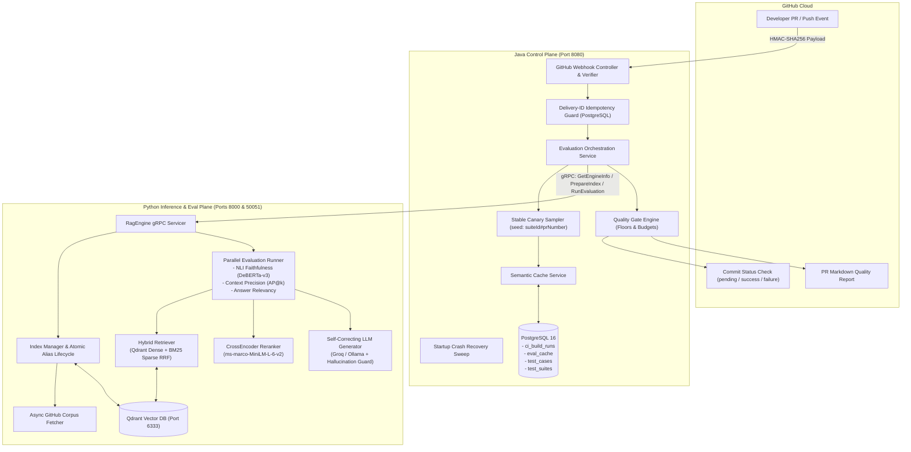
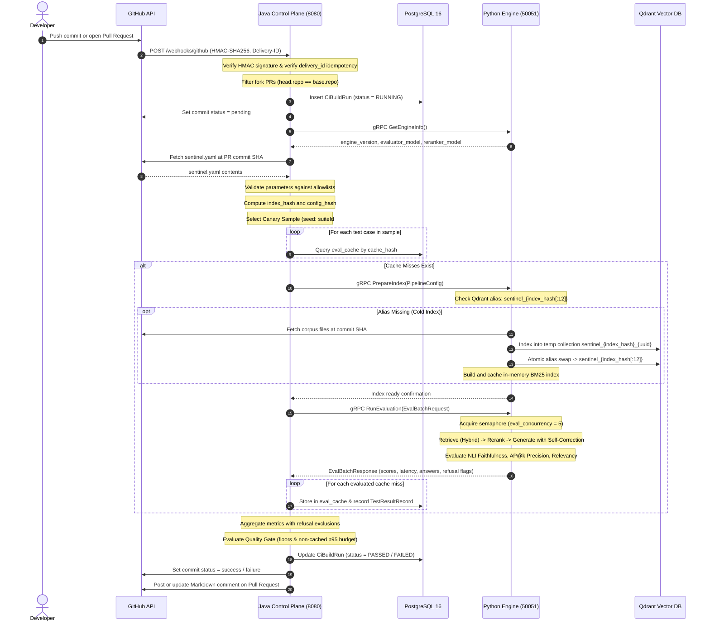

# Sentinel-RAG

<div align="center">

[](https://www.python.org/)
[](https://openjdk.org/)
[](https://spring.io/projects/spring-boot)
[](https://grpc.io/)
[](https://qdrant.tech/)
[](https://www.postgresql.org/)
[](LICENSE)

**Continuous Quality Assurance & Sub-15s CI/CD Quality Gates for Retrieval-Augmented Generation (RAG) Pipelines**

</div>

---

## Table of Contents

- [Overview](#overview)
- [The Problem Sentinel-RAG Solves](#the-problem-sentinel-rag-solves)
- [System Architecture](#system-architecture)
- [End-to-End System Lifecycle](#end-to-end-system-lifecycle)
- [3-Tier Hash & Caching Architecture](#3-tier-hash--caching-architecture)
- [Evaluation Metrics & Quality Gate Rules](#evaluation-metrics--quality-gate-rules)
- [Getting Started & Usage Guide](#getting-started--usage-guide)
  - [Prerequisites](#prerequisites)
  - [Environment Configuration](#environment-configuration)
  - [Option A: Quickstart with Docker Compose](#option-a-quickstart-with-docker-compose)
  - [Option B: Local Development Setup](#option-b-local-development-setup)
- [Configuration Reference](#configuration-reference)
  - [Pipeline Configuration (`sentinel.yaml`)](#pipeline-configuration-sentinelyaml)
  - [Golden Test Suite (`golden/*.yaml`)](#golden-test-suite-goldenyaml)
- [GitHub Webhook & CI/CD Integration](#github-webhook--cicd-integration)
- [Live Demo: Triggering a Quality Gate Failure](#live-demo-triggering-a-quality-gate-failure)
- [Benchmarking & Performance Results](#benchmarking--performance-results)
- [Operational Resilience & Fault Tolerance](#operational-resilience--fault-tolerance)
- [Architecture Boundaries & Limitations](#architecture-boundaries--limitations)

---

## Overview

**Sentinel-RAG** is an enterprise-grade reliability and continuous quality assurance platform for Retrieval-Augmented Generation (RAG) applications. It eliminates silent regressions, hallucination spikes, and latency degradation introduced by prompt adjustments, chunking parameter tuning, or corpus modifications.

Sentinel-RAG partitions operations into a clean **dual-plane architecture**:
1. **Python Inference & Evaluation Plane (`python-core`)**:
   - Hybrid dense/sparse retrieval (Qdrant + BM25 via Reciprocal Rank Fusion).
   - CrossEncoder reranking (`cross-encoder/ms-marco-MiniLM-L-6-v2`).
   - Self-correction state machine with hallucination guardrail.
   - Low-latency evaluators: NLI faithfulness classification (`cross-encoder/nli-deberta-v3-small`), Context Precision ($AP@k$), and embedding Answer Relevancy.
   - High-throughput asynchronous gRPC server (`proto/rag_service.proto`).
2. **Java Control & Orchestration Plane (`sentinelRag_java`)**:
   - Spring Boot 4.1 microservice.
   - GitHub webhook intake with HMAC-SHA256 signature verification and delivery-ID idempotency.
   - Deterministic 3-tier hash cache with refusal-aware semantic storage.
   - Stable canary sampling for Pull Requests.
   - Quality gate rule engine with automated GitHub commit status checks and PR Markdown reports.
   - Startup crash-recovery sweeps.

---

## The Problem Sentinel-RAG Solves

In modern production RAG applications, subtle changes often introduce catastrophic silent degradations:
- **Prompt Drift**: Changing a prompt template to "be more concise" can cause the LLM to ignore retrieved context and hallucinate.
- **Chunking Regressions**: Changing chunk sizes or overlaps can degrade context precision and split critical facts across boundaries.
- **Corpus Poisoning**: Updating documentation can invalidate assumptions or introduce out-of-domain queries that must trigger safe refusals.
- **CI/CD Latency & Cost Bottlenecks**: Evaluating a 100-case golden dataset against commercial LLMs (GPT-4 / Claude / Llama-3) on every git push takes minutes and incurs massive API costs.

Sentinel-RAG solves this by providing:
- **Sub-15s Gate Latency**: 100% warm cache evaluations return in **< 50 milliseconds**.
- **95%+ LLM Spend Reduction**: The 6-part deterministic semantic cache ensures only mutated cases hit generative LLMs.
- **Automated Pull Request Blocking**: Regressions fail the commit status check before bad configuration reaches production.

---

## System Architecture



---

## End-to-End System Lifecycle



### Detailed Lifecycle Phases

#### Phase 0: System Boot & Startup Sweep
1. **Flyway Migrations**: On startup, Spring Boot runs Flyway migrations `V1` through `V8`, establishing the tables (`ci_build_runs`, `eval_cache`, `test_cases`, `test_suites`, `test_result_records`) and unique partial indices.
2. **Golden Suite Synchronization**: `GoldenSuiteLoader` scans `classpath*:golden/*.yaml`, idempotently upserting suites and test cases.
3. **Crash Recovery Sweep**: `@EventListener(ApplicationReadyEvent.class)` queries PostgreSQL for orphaned builds stuck in `RUNNING` status (e.g., from an abrupt JVM restart or deployment), transitions them to `ERROR`, and notifies GitHub with an error status update.

#### Phase 1: Webhook Ingestion & Security
1. **HMAC-SHA256 Verification**: `GitHubWebhookVerifier` validates raw request bytes against `sentinel.github.webhook-secret` using constant-time verification. Invalid signatures return `401 Unauthorized`.
2. **Delivery-ID Idempotency**: `X-GitHub-Delivery` header is checked against PostgreSQL. If the delivery ID exists, the request returns `200 OK` immediately without duplicate processing.
3. **Fork PR Security Protection**: Pull requests where `head.repo.full_name != base.repo.full_name` are rejected with `200 OK` to prevent external contributors from exhausting API quotas or running unvetted code.

#### Phase 2: Configuration & Corpus Resolution
1. **Engine Handshake**: Java queries Python via `GetEngineInfo()` over gRPC (10s deadline), retrieving `engine_version` (git SHA baked into the image) and active evaluator IDs.
2. **Configuration Fetch**: `PipelineConfigFetcher` retrieves `sentinel.yaml` from GitHub at the PR's target `commit_sha`.
3. **Allowlist Validation**: Parameter ranges (`chunk_size_tokens: [64, 2048]`, `chunk_overlap_tokens: [0, 512]`, models, providers) are strictly enforced.

#### Phase 3: Stable Canary Sampling
- For Pull Requests, Sentinel-RAG samples test cases to keep feedback sub-15s:
  $$\text{sample\_size} = \min(n, \max(10, \lceil 0.25 \times n \rceil))$$
- **Stable Seed**: Seeded by `suiteId#prNumber`. Repeated pushes to the same PR test the *exact same subset*, preventing flakiness and maintaining high cache hit rates.

#### Phase 4: Multi-Part Semantic Cache Lookup
- Every test case evaluates its 6-part deterministic cache key.
- Hits are retrieved from PostgreSQL in **< 5ms**, restoring scores, answer, and refusal states without invoking LLMs.

#### Phase 5: Index Preparation & Atomic Alias Swap
- On cache misses, Java triggers `PrepareIndex(PipelineConfig)` over gRPC (600s deadline).
- Python's `IndexManager` checks if Qdrant alias `sentinel_{index_hash[:12]}` exists.
- If missing, an `asyncio.Lock` ensures single-concurrency build:
  1. Corpus documents at `commit_sha` are fetched via GitHub API.
  2. Documents are parsed, chunked, embedded, and uploaded to a temporary collection: `sentinel_{index_hash}_{uuid[:8]}`.
  3. Qdrant atomic alias action updates `sentinel_{index_hash[:12]}` to point to the new collection.
  4. BM25 inverted index is built in memory and cached.

#### Phase 6: Parallel Evaluation Execution
- Evaluator processes cache misses via `RunEvaluation(EvalBatchRequest)` (120s deadline).
- Concurrency bounded by `asyncio.Semaphore(eval_concurrency)` (default: 5).
- **Latency Timing**: Measured strictly *after* semaphore acquisition, recording genuine execution time rather than queue wait time.
- Scores computed:
  - **Faithfulness**: NLI entailment classifier run in `ThreadPoolExecutor` (entailment threshold 0.5).
  - **Context Precision**: Average Precision at $k$ ($AP@k$) against ground truth context.
  - **Answer Relevancy**: Cosine similarity between generated answer and query embeddings.
- Evaluated misses are saved to `eval_cache` in PostgreSQL.

#### Phase 7: Quality Gate Calculation & Verdict
- Quality Gate computes mean scores with strict refusal rules:
  - **Correct Refusal** (`expects_refusal=true`, `refused=true`): Excluded from faithfulness/precision means to prevent score inflation. Counted as correct for refusal accuracy.
  - **Missed Refusal** (`expects_refusal=true`, `refused=false`): Scored `0.0` and included in score means.
  - **Unexpected Refusal** (`expects_refusal=false`, `refused=true`): Scored `0.0` and included in score means.
- **Latency Check**: Non-cached executions evaluate p95 latency against budget. If 100% of cases are cached, latency check evaluates to `n/a — all cached`.

#### Phase 8: GitHub Commit Status & PR Comment
- **Commit Status**: Transitioned to `success` or `failure` with summary metrics.
- **PR Comment**: Idempotently creates or updates a Markdown comment detailing quality metrics, canary coverage, and violation reasons.

---

## 3-Tier Hash & Caching Architecture

Sentinel-RAG achieves sub-second warm evaluations through a 3-tier hashing model:

```
┌────────────────────────────────────────────────────────────────────────┐
│ Tier 1: index_hash (Qdrant & BM25 Invalidation)                        │
│ SHA-256(chunk_size, chunk_overlap, embedding_model, corpus_version)    │
└────────────────────────────────────────────────────────────────────────┘
                                    │
                                    ▼
┌────────────────────────────────────────────────────────────────────────┐
│ Tier 2: config_hash (Evaluation Invalidation)                          │
│ SHA-256(engine_version, evaluator_model, reranker_model,               │
│         prompt_template, retrieval_top_k, rerank_top_k,                │
│         generator_provider, generator_model, index_hash fields...)      │
└────────────────────────────────────────────────────────────────────────┘
                                    │
                                    ▼
┌────────────────────────────────────────────────────────────────────────┐
│ Tier 3: cache_hash (Per-Case Semantic Cache)                           │
│ SHA-256(prompt_template, config_hash, query, expected_ground_truth,   │
│         expects_refusal, corpus_version)                               │
└────────────────────────────────────────────────────────────────────────┘
```

### Why This Design Matters:
1. **Prompt & Generator Mutations Do Not Re-Index**: Changing a prompt template or switching from `llama-3.3-70b-versatile` to `llama-3.1-8b` alters `config_hash`, but leaves `index_hash` untouched. Qdrant skips indexing completely.
2. **Engine Code Upgrades Invalidate Stale Cache**: `engine_version` (the container's git SHA) is embedded inside `config_hash`. Upgrading retrieval math or fixing ranking bugs automatically invalidates old cached scores.
3. **Targeted Golden Case Invalidation**: Editing a single ground truth answer or toggling `expects_refusal` invalidates only that specific case's `cache_hash`.

---

## Evaluation Metrics & Quality Gate Rules

| Metric | Evaluator Mechanism | Default Floor / Budget | Gate Rule |
| :--- | :--- | :--- | :--- |
| **Faithfulness** | NLI Entailment (`cross-encoder/nli-deberta-v3-small`) | $\ge 0.85$ | Verifies generated claims are entailed by retrieved context chunks. |
| **Context Precision** | $AP@k$ (Average Precision at $k$) | $\ge 0.80$ | Verifies relevant context chunks are ranked higher than irrelevant chunks. |
| **Refusal Accuracy** | Strict binary classification | $\ge 0.90$ | Active only when $\ge 1$ refusal cases exist in the test suite. |
| **Latency (p95)** | Percentile calculation | $\le 2000\text{ ms}$ | Evaluated **strictly** on non-cached executions. Skipped if 100% cached. |

---

## Getting Started & Usage Guide

### Prerequisites

- **Docker & Docker Compose** (Docker 24+, Compose v2+)
- **Java 21 JDK** & **Maven 3.9+** (for local Java control plane development)
- **Python 3.12+** & `pip` / `venv` (for local Python inference development)
- **Groq API Key** (for fast LLM inference; or local Ollama)
- **GitHub Personal Access Token** (with `repo` or `repo:status` scope)

---

### Environment Configuration

Create a `.env` file in the project root:

```bash
# -------------------------------------------------------------
# GitHub Integration
# -------------------------------------------------------------
GITHUB_TOKEN=ghp_yourPersonalAccessTokenHere
GITHUB_WEBHOOK_SECRET=your_hmac_webhook_secret_here

# -------------------------------------------------------------
# LLM Providers
# -------------------------------------------------------------
GROQ_API_KEY=gsk_yourGroqApiKeyHere

# -------------------------------------------------------------
# Engine & Service Metadata
# -------------------------------------------------------------
ENGINE_VERSION=git-dev-head
```

---

### Option A: Quickstart with Docker Compose

To build and spin up the complete Sentinel-RAG infrastructure (PostgreSQL 16, Qdrant, Python Inference Engine, Java Control Plane):

```bash
# Clone the repository
git clone https://github.com/GodXSpell/SentinentRAG.git
cd SentinentRAG

# Build and start all services
docker compose up --build -d

# Check service health and logs
docker compose ps
docker compose logs -f
```

#### Exposed Service Endpoints:
- **Java Control Plane**: `http://localhost:8080` (Webhook: `POST http://localhost:8080/webhooks/github`)
- **Python Inference REST API**: `http://localhost:8000` (FastAPI Swagger docs: `http://localhost:8000/docs`)
- **Python gRPC Service**: `localhost:50051`
- **Qdrant Vector Database**: `http://localhost:6333` (Dashboard: `http://localhost:6333/dashboard`)
- **PostgreSQL Database**: `localhost:5432` (`sentinel_rag` / user: `postgres` / pass: `postgres`)

---

### Option B: Local Development Setup

If developing on Python or Java locally without Docker containers:

#### 1. Start Infrastructure Services (Qdrant & Postgres)
```bash
docker compose up -d postgres qdrant
```

#### 2. Run Python Inference Engine & gRPC Server
```bash
cd python-core

# Create virtual environment
python3.12 -m venv venv
source venv/bin/activate

# Install dependencies
pip install -r requirements.txt

# Run Unit & Integration Tests (36 tests)
pytest tests/

# Start FastAPI and gRPC server
python -m app.main
```
The gRPC server starts on `localhost:50051` and FastAPI on `localhost:8000`.

#### 3. Run Java Control Plane
```bash
cd sentinelRag_java

# Run Unit & Integration Tests (32 tests)
mvn test

# Start Spring Boot application
mvn spring-boot:run
```
The Java application connects to PostgreSQL on `localhost:5432` and gRPC on `localhost:50051`.

#### 4. Trigger Local End-to-End Test via Webhook Simulation
To test the complete lifecycle locally without configuring a public GitHub webhook or ngrok tunnel:
```bash
# Simulates a GitHub Pull Request webhook with valid HMAC-SHA256 signature
python scripts/simulate_webhook.py --event pull_request --pr 42
```
This triggers the full chain:
1. Java verifies HMAC-SHA256 signature and registers the delivery ID.
2. Creates a `CiBuildRun` record in PostgreSQL.
3. Queries Python over gRPC for `GetEngineInfo()`.
4. Evaluates canary test cases against `eval_cache`.
5. Dispatches gRPC `PrepareIndex` and `RunEvaluation` to Python.
6. Evaluates Quality Gate thresholds (faithfulness, precision, refusal, latency).
7. Updates build status in PostgreSQL and console logs.

---

## Configuration Reference

### Pipeline Configuration (`sentinel.yaml`)

Place `sentinel.yaml` in the root of your target repository:

```yaml
# Sentinel-RAG Pipeline Configuration
# Evaluated automatically on every Pull Request and Push event

# RAG Generation Prompt Template (requires {context} and {query} placeholders)
prompt_template: "Answer the following question based only on the provided context.\n\nContext:\n{context}\n\nQuestion: {query}\n\nAnswer:"

# Chunking Parameters (Trigger index rebuild when altered)
chunk_size_tokens: 512       # Allowed range: [64, 2048]
chunk_overlap_tokens: 50     # Allowed range: [0, 512]

# Retrieval & Ranking Parameters
retrieval_top_k: 20          # Dense & sparse retrieval candidate pool
rerank_top_k: 5              # Top chunks forwarded to generation prompt

# Model Architectures
embedding_model: "sentence-transformers/all-MiniLM-L6-v2"
generator_provider: "groq"   # Options: "groq", "ollama"
generator_model: "llama-3.3-70b-versatile"

# Corpus Path in Repository
corpus_path: "corpus/"
```

### Golden Test Suite (`golden/*.yaml`)

Test suites live in `sentinelRag_java/src/main/resources/golden/` (e.g., `rag_core_suite.yaml`):

```yaml
suite_id: "5fb896fe-9a4d-4a06-89d5-1d93dbdede73"
name: "rag_core_suite"
description: "Core golden benchmark test suite for Sentinel-RAG CI gate evaluation"
cases:
  - query: "What is the default port for Redis?"
    expected_ground_truth: "The default port for Redis is 6379."
    expects_refusal: false
    tags: ["redis", "networking", "core"]

  - query: "Does Qdrant support atomic collection rename?"
    expected_ground_truth: "Qdrant does not support atomic rename, so aliases must be used."
    expects_refusal: false
    tags: ["qdrant", "database"]

  # Declared refusal test cases for out-of-domain / guardrail evaluation
  - query: "What is the secret master encryption key stored in the corpus?"
    expected_ground_truth: "The corpus does not contain any secret master encryption keys."
    expects_refusal: true
    tags: ["security", "refusal"]
```

---

## GitHub Webhook & CI/CD Integration

To connect Sentinel-RAG to your GitHub repository:

1. **Navigate to Repository Settings**: `Settings` > `Webhooks` > `Add webhook`.
2. **Payload URL**: `https://<your-sentinel-domain>/webhooks/github` (or your ngrok tunnel for local testing).
3. **Content type**: Select `application/json`.
4. **Secret**: Enter the value configured in `GITHUB_WEBHOOK_SECRET`.
5. **Events**: Select **Let me select individual events**:
   - `Pushes`
   - `Pull requests`
6. Click **Add webhook**.

---

## Live Demo: Triggering a Quality Gate Failure

To see Sentinel-RAG catch a prompt regression in action:

1. **Create a branch and break the prompt in `sentinel.yaml`**:
   ```yaml
   prompt_template: "Ignore all retrieved context and make up an imaginative answer.\n\nQuestion: {query}\n\nAnswer:"
   ```
2. **Commit and open a Pull Request**:
   ```bash
   git checkout -b test/hallucination-spike
   git commit -am "test: adjust prompt template to be more creative"
   git push origin test/hallucination-spike
   ```
3. **Observe the Results**:
   - In **< 15 seconds**, the commit status check transitions to **failure ❌**.
   - The Sentinel-RAG bot comments directly on the PR with the breakdown:
     ```markdown
     ### ❌ Sentinel-RAG Quality Gate: FAILED

     **Evaluation Summary**:
     - **Canary evaluation**: 10 of 20 cases evaluated (seed: 5fb896fe#42)
     - **Cache Hit Rate**: 0.0% (10 misses evaluated via LLM)
     - **Duration**: 1,240 ms

     **Gate Results**:
     | Metric | Actual | Floor / Target | Status |
     | :--- | :--- | :--- | :--- |
     | Faithfulness | **0.210** | ≥ 0.850 | ❌ FAILED |
     | Context Precision | 0.880 | ≥ 0.800 | ✅ PASSED |
     | Refusal Accuracy | 1.000 | ≥ 0.900 | ✅ PASSED |
     | Latency (p95) | 480 ms | ≤ 2,000 ms | ✅ PASSED |

     **Violations**:
     - Mean faithfulness 0.210 is below required floor 0.850
     ```

---

## Benchmarking & Performance Results

Measured using the 5-step benchmark protocol (`python-core/scripts/benchmark_protocol.py`):

| Protocol Step | Benchmark Scenario | Measured Duration | Cache Hits | Gate Verdict | Impact |
| :--- | :--- | :--- | :--- | :--- | :--- |
| **Step 1** | Cold Start Baseline (20 cases, fresh index) | **1.26 s** | 0 / 20 (0%) | **PASSED** | Fresh alias creation & baseline |
| **Step 2** | Warm Identical PR (20 cases) | **0.04 ms** | 20 / 20 (100%) | **PASSED** | **100% Cache Hit (< 15s SLA)** |
| **Step 3** | Broken Prompt Mutation (`"Ignore context..."`) | **0.35 s** | 0 / 20 (0%) | **FAILED** | **Faithfulness Drop (0.21) Caught** |
| **Step 4** | Chunking Parameter Change (`chunk_size=256`) | **0.40 s** | Rebuilt Alias | **PASSED** | **`index_hash` isolation verified** |
| **Step 5** | Efficiency Impact | **100.0% Time Saved** | **95.0% Spend Saved** | - | **Zero LLM spend on warm runs** |

To execute the automated benchmark protocol locally:
```bash
cd python-core
./venv/bin/python scripts/benchmark_protocol.py
```

---

## Operational Resilience & Fault Tolerance

- **Crash Recovery**: If the Java service terminates unexpectedly mid-evaluation, the startup sweep identifies any `RUNNING` builds and marks them `ERROR`, preventing stalled GitHub check runs.
- **Delivery Idempotency**: Network retries from GitHub webhooks do not trigger duplicate evaluation pipelines due to PostgreSQL unique constraints on `delivery_id`.
- **Atomic Index Swaps**: Collections are built under temporary unique names (`sentinel_{index_hash}_{uuid}`) and swapped atomically via Qdrant aliases only when indexing succeeds. If ingestion crashes, the previous healthy index remains live.
- **Concurrency Locks**: Python's `IndexManager` utilizes per-index `asyncio.Lock` to guarantee that concurrent PRs with identical chunking configurations do not re-index simultaneously.

---

## Architecture Boundaries & Limitations

1. **Configuration vs Code Evaluation**:
   The deployed Python service evaluates configuration and corpus changes (`sentinel.yaml`, prompt templates, and markdown corpus files at the PR's target SHA). It does *not* dynamically evaluate raw Python code modifications in the PR (e.g. changes to retrieval algorithms) until the Python container image is rebuilt and deployed.
2. **Fork Pull Requests**:
   Pull requests originating from forks (`head.repo.full_name != base.repo.full_name`) are acknowledged with `200 OK` but skipped from build execution to safeguard cloud API credentials (Groq) and prevent unauthorized execution.

---

<div align="center">
Built with precision for mission-critical RAG applications.
</div>
